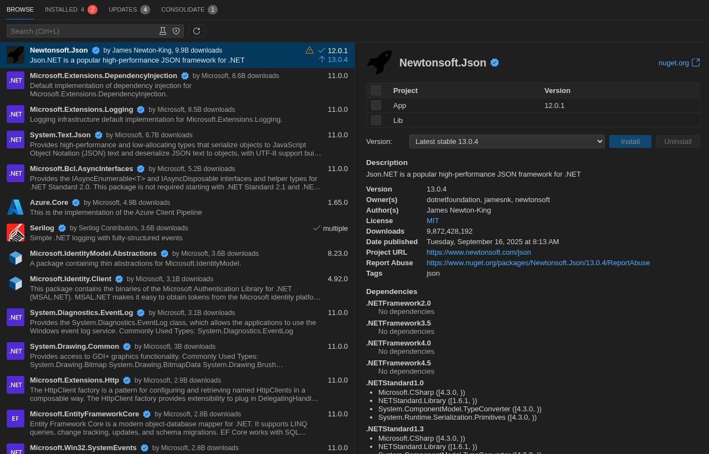

# Packwise

Manage the NuGet packages of your .NET solutions in a package manager modelled on Visual Studio's
**Manage NuGet Packages for Solution** window: browse, install, update, uninstall and consolidate packages, with
vulnerable and deprecated versions flagged.



## Features

- Search the package sources of your `NuGet.Config` and see, on each result, which version your projects use.
- Install, update and uninstall packages in one or several projects of the solution at once.
- Update every outdated package in one go from the **Updates** tab.
- Spot vulnerable, deprecated and unlisted versions before picking one.
- Align packages installed with different versions across projects (**Consolidate**).
- English and French user interface.


## Requirements

- The .NET SDK (`dotnet` on `PATH`).
- A `.sln` or `.slnx` file referencing the `.csproj` projects.
- Network access for latest versions, vulnerabilities and details. Offline, installed packages are still shown with a warning.

## Usage

The **Packwise** icon appears in the activity bar when the workspace contains a solution (`bin`, `obj`, `node_modules`
and `packages` folders are ignored). Clicking it opens the package manager of the solution in an editor tab. With
several solutions, the sidebar lists them: pick one, and the icon then reopens the last one used.
**Manage Packages…** is also in the context menu of a `.sln`/`.slnx` file in the Explorer, in the editor title of an
open solution file, and in the command palette. The `packwise.ecosystems` setting turns an ecosystem off.

| Tab | Content |
|---|---|
| **Browse** | Search the package sources (infinite scroll); installed versions and updates are shown on each row |
| **Installed** | Top-level packages, then transitive ones (collapsed) |
| **Updates** | Outdated top-level packages, with check boxes and **Update** for several packages at once |
| **Consolidate** | Packages installed with different versions across the projects |

The toolbar has the search box (`Ctrl+L`), **Refresh**, **Include prerelease** and the **Package source** picker
(enabled HTTP(S) sources of `dotnet nuget list source`, or all of them). Selecting a package shows its details: the
projects of the solution and their version, the version picker (latest stable/prerelease, vulnerable, deprecated and
unlisted versions flagged), **Install**/**Uninstall** for the checked projects, vulnerability and deprecation notices,
metadata (owners, authors, license, downloads, publication date, URLs, tags) and dependencies per target framework.
Changes run through `dotnet add/remove package` with a cancellable progress notification; the commands and their
output are written to the **Packwise** output channel.

The panel reloads when a project file or the solution changes, so edits made outside the extension show up too.
A project that was never restored is restored automatically.

## Limitations

- Only `.csproj` projects of the solution are handled.
- Installing a transitive package adds a top-level reference to the project file.
- Sources needing credentials and local folder or NuGet v2 sources are not browsed (they are still used by `dotnet`
  when installing).

## Development

Installed and outdated packages come from the `dotnet list package` CLI; search, version history and metadata from
the NuGet v3 API of the configured package sources.

```sh
npm ci
npm test          # unit tests (node:test, native TypeScript)
npm run typecheck
npm run build     # bundle to dist/extension.cjs and dist/webview.js (F5 in VS Code to debug)
npm run package   # produce packwise-<version>.vsix
```

Install a build with `code --install-extension packwise-<version>.vsix`. The CI keeps the `.vsix` of every pipeline as a job artifact (90 days). Pushing a `vX.Y.Z` tag matching the `package.json` version also stores it in the package registry and creates a GitLab release linking to it.

## License

[MIT](LICENSE)

Packwise is an independent project, not affiliated with or endorsed by Microsoft or the .NET Foundation.
