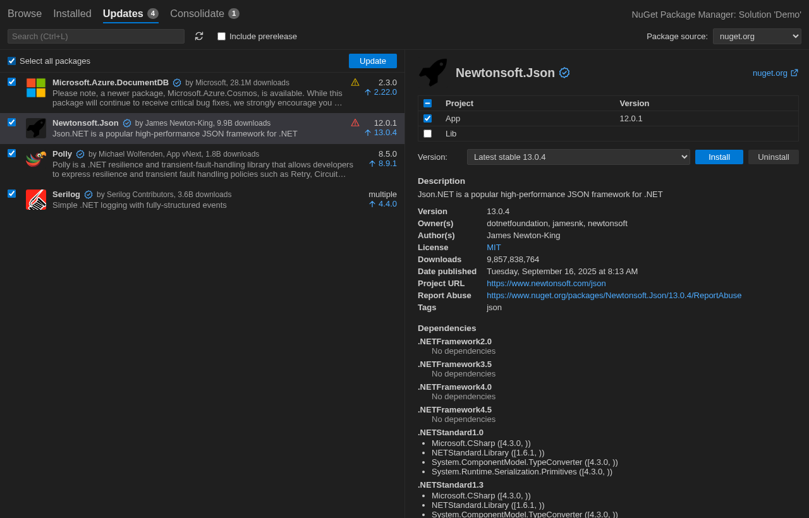

# Packwise

Manage the NuGet packages of your .NET solutions, the npm packages of your JavaScript projects and the PyPI packages of
your Python projects in a package manager modelled on Visual Studio's **Manage NuGet Packages for Solution** window: browse, install, update, uninstall and
consolidate packages, with vulnerable and deprecated versions flagged.


## Features

- **NuGet** (.NET solutions), **npm** (`package.json`, workspaces included) and **PyPI** (`pyproject.toml` managed by
  [uv](https://docs.astral.sh/uv/), workspaces included) in the same panel.
- Search the package sources of your `NuGet.Config`, the registries of your `.npmrc` or pypi.org and see, on each
  result, which version your projects use.
- Install, update and uninstall packages in one or several projects of a solution or a workspace at once.
- Update every outdated package in one go from the **Updates** tab.
- Spot vulnerable, deprecated and unlisted versions before picking one.
- Align packages installed with different versions across projects (**Consolidate**).
- English and French user interface.



## Requirements

- NuGet: the .NET SDK (`dotnet` on `PATH`) and a `.sln` or `.slnx` file referencing the `.csproj` projects.
- npm: Node.js and npm (`npm` on `PATH`), and a `package.json`. Run `npm install` first so that installed versions,
  transitive packages and vulnerabilities (which need `package-lock.json`) are available.
- PyPI: uv (`uv` on `PATH`) and a `pyproject.toml` with a `[project]` table. Installed and transitive packages come from
  `uv.lock` (run `uv lock` or `uv sync` first); vulnerabilities from [OSV.dev](https://osv.dev).
- Network access for latest versions, vulnerabilities and details. Offline, installed packages are still shown with a warning.

## Usage

The **Packwise** icon appears in the activity bar when the workspace contains a solution, a `package.json` or a
`pyproject.toml` (`node_modules` and virtual environment folders are ignored, and `bin`, `obj` and `packages` for
solutions, as well as files ignored by git, such as the copies that build outputs like `.next/` make). Each solution, workspace root (npm or uv) or standalone project is a root; the members of a workspace are
the projects of its root. Clicking the icon
opens the package manager of the root in an editor tab. With several roots, the sidebar lists them (grouped by
ecosystem when there are several): pick one, and the icon then reopens the last one used.
**Manage Packages…** is also in the context menu of a `.sln`/`.slnx`, `package.json` or `pyproject.toml` file in the Explorer, in the
editor title of an open one, and in the command palette. The `packwise.ecosystems` setting turns an ecosystem off
(for example `"packwise.ecosystems": { "npm": false }`).

| Tab | Content |
|---|---|
| **Browse** | Search the package sources (infinite scroll); installed versions and updates are shown on each row |
| **Installed** | Top-level packages, then transitive ones (collapsed); the tab shows their count and, in red, the number of vulnerable packages |
| **Updates** | Outdated top-level packages, with check boxes and **Update** for several packages at once |
| **Consolidate** | Packages installed with different versions across the projects |

The toolbar has the search box (`Ctrl+L`) with two filter toggles, **Include prerelease** (beaker) and **Vulnerable
only** (shield), then **Refresh** and the **Package source** picker (enabled HTTP(S) sources of
`dotnet nuget list source`, or all of them; hidden when there is a single source). The vulnerability flag of a row is
coloured by the worst severity of the installed versions (critical, high, moderate, low). Selecting a package shows its details: the
projects of the solution and their version, the version picker (latest stable/prerelease, vulnerable, deprecated and
unlisted versions flagged), **Install**/**Uninstall** for the checked projects, vulnerability and deprecation notices,
metadata (owners, authors, license, downloads, publication date, URLs, tags) and dependencies per target framework
(per dependency type for npm, per extra for PyPI). Changes run through `dotnet add/remove package`,
`npm install/uninstall` or `uv add/remove` with a
cancellable progress notification; the commands and their output are written to the **Packwise** output channel.

For npm, dependency types are shown as badges (`dev`, `peer`, `optional`) and kept on update, as is the range prefix
(`^`, `~` or an exact version). A new reference goes to `dependencies`, or to `devDependencies` with the
**Development dependency** option.

For PyPI, optional dependencies (`[extra]`) and dependency groups (`dev`, …) are shown as badges and kept on update, as
are the extras, environment marker and operator (`==`, `>=`, `~=`) of the requirement; other specifiers become `>=`.
A new reference goes to `[project].dependencies`, or to the `dev` group with the **Development dependency** option.

The panel reloads when a project file or the solution changes, so edits made outside the extension show up too.
A project that was never restored is restored automatically.

## Limitations

- NuGet: only `.csproj` projects of the solution are handled. Sources needing credentials and local folder or NuGet v2
  sources are not browsed (they are still used by `dotnet` when installing).
- npm: projects managed by pnpm or Yarn (`packageManager` field or lockfile) are read-only: their packages, installed
  and latest versions are shown, changes are left to their own CLI. Registries needing credentials are not browsed
  (they are still used by `npm` when installing). Local, Git and `workspace:` dependencies are not listed.
- PyPI: only uv is driven; Poetry, PDM and Pipenv projects (lock file or `[tool.poetry]`) are read-only. Only pypi.org is
  browsed: PyPI has no search API, so a search looks up the exact package name, and the dependencies are known for the
  latest version only. Custom indexes are not browsed (they are still used by `uv`). Direct references
  (`name @ url`), path and Git dependencies are not listed.
- Installing a transitive package adds a top-level reference to the project file.

## Development

Each ecosystem implements the `Ecosystem` interface (`src/ecosystem.ts`) in `src/ecosystems/<id>/`. NuGet: installed
and outdated packages come from the `dotnet list package` CLI; search, version history and metadata from the NuGet v3
API of the configured package sources. npm: installed, outdated and vulnerable packages come from `npm ls`,
`npm outdated` and `npm audit`; search, version history and metadata from the registry API. PyPI: installed packages
come from `pyproject.toml` and `uv.lock`, versions from the PyPI simple and JSON APIs, vulnerabilities from OSV.dev;
changes run through `uv add/remove`.

```sh
npm ci
npm test          # unit tests (node:test, native TypeScript)
npm run typecheck
npm run build     # bundle to dist/extension.cjs and dist/webview.js (F5 in VS Code to debug)
npm run package   # produce packwise-<version>.vsix
```

Install a build with `code --install-extension packwise-<version>.vsix`. The CI keeps the `.vsix` of every pipeline as a job artifact (90 days). Pushing a `vX.Y.Z` tag matching the `package.json` version also stores it in the package registry and creates a GitLab release linking to it.

## License

[MIT](LICENSE)

The webview icons are [Codicons](https://github.com/microsoft/vscode-codicons) by Microsoft, licensed under
[CC BY 4.0](https://creativecommons.org/licenses/by/4.0/).

Packwise is an independent project, not affiliated with or endorsed by Microsoft, the .NET Foundation, GitHub, npm, Inc., the
Python Software Foundation or Astral.
